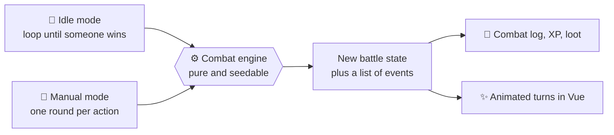

<div align="center">

# ⚔️ Ascendants

**An idle and turn-based mage guild game, built by hand with Laravel and Vue.**

Send your heroes out, close the app, come back to loot and a combat log.<br>
Later, take the wheel and fight turn by turn.

<br>


<br>

[💡 The idea](#-the-idea) ·
[🎮 Game design](#-game-design) ·
[🏗️ Architecture](#%EF%B8%8F-architecture-principles) ·
[🧰 Tech stack](#-tech-stack) ·
[🗺️ Roadmap](#%EF%B8%8F-roadmap) ·
[🚀 Getting started](#-getting-started)

</div>

<br>

> [!NOTE]
> **Status: planning.** Phase 0 (idle mode with placeholder results and starter heroes) is next.

## 💡 The idea

You start as a young mage, grow into a guild master, and send your heroes out on timed missions. Ascendants has two play modes that share one combat engine.

| | 🌙 Idle mode | 🎯 Manual mode |
| --- | --- | --- |
| **Built** | First | Later |
| **How it plays** | Pick a hero and an activity (for example, Goblin Cave, 5 minutes) and close the app | Start a battle against a monster (or later another user) and choose an action each turn |
| **What the server does** | A queued job resolves the whole fight round by round when the timer ends | Runs one round per player action |
| **What you get** | XP, loot, and a combat log to read next login | Events returned for Vue to animate |

> [!TIP]
> Idle timers stay short, **2 to 10 minutes**, not hours. That keeps the game lively and makes the queued jobs easy to test and demo.

**The key idea:** idle mode loops the engine until someone wins, and manual mode advances it one round per player action. Nothing built for idle mode is thrown away.



## 🎮 Game design

### 🏰 Story: you run a guild

1. The player starts as a young mage.
2. At level X (to be decided), the player can open a guild.
3. People come to join the guild.
4. The player can send out idle recruiting runs to attract more members.

### 🧙 Heroes

All heroes are mages, and every hero has an element and a sub typing (for now).

- **Main typing (element).** Borrowed from the Pokemon idea of types. It decides strengths and weaknesses in combat.
- **Sub typing (role).** Likely driven by stats, such as DPS, Support, Balanced, or Tank.

| Group | Typings |
| --- | --- |
| **Starter typings** | 🌬️ Air · 🔥 Fire · 💧 Water · 🪨 Earth (the four Avatar elements) |
| **More typings, added later** | ✨ Light · 🌑 Dark · 👤 Shadows · 🧚 Fairy · 🐉 Dragon · 🧛 Vampire · 🌌 Space · 🕳️ Gravity |
| **Roles (sub typing)** | 🗡️ DPS · 💚 Support · ⚖️ Balanced · 🛡️ Tank, and more as stats grow |

### 🕹️ Idle activities

| Activity | Options | Notes |
| --- | --- | --- |
| ⚔️ **Battle** | Dungeon, Forest, City | Fights resolve into a combat log |
| 🏋️ **Training** | Level up, or train each stat | Individual stats get added later |
| 💎 **Look for gear and items** | Loot hunting | Drops should be exciting |
| 📜 **Quest** | Any of the activities above | Wraps another activity with a goal |

### 💥 Combat

Combat follows the Pokemon model.

| Multiplier | Meaning | Notes |
| :---: | --- | --- |
| 🚫 **0x** | Immune | Rare, only for a few matchups |
| 🛡️ **0.5x** | Not very effective | |
| ⚖️ **1x** | Normal | |
| 💥 **2x** | Super effective | |
| 💥💥 **4x** | Double super effective | Possible, undecided. Needs a second typing on a hero or move |
| ⭐ **1.5x** | Critical hit | Applies on top of the type multiplier |

| Action | What it does | Status |
| --- | --- | --- |
| ⚔️ **Attack** | Each hero picks from 2 moves. A move is either an attack move or a buff/debuff move | Core |
| 🎒 **Items** | Use an item during battle | Later |
| 🏃 **Run** | Leave the battle | Core |
| 🔄 **Switch** | Swap in a different hero | Core |

> [!TIP]
> The type chart lives in data (a table or config file), not in conditionals, so adding the later typings is a data change instead of a code change.

## 🏗️ Architecture principles

Five decisions made on day one keep every later phase cheap.

1. **The server is the only source of truth.** Vue displays state and submits choices. It never computes damage, loot, or outcomes.
2. **The combat engine is pure and stateless between rounds.** It takes a battle state in and returns a new state plus a list of events. No database calls, no `request()`, no `now()` inside it.
3. **Randomness is seedable.** Inject a random number generator that accepts a seed. Tests become deterministic and any battle can be replayed exactly.
4. **Everything notable is an event.** `QuestStarted`, `QuestCompleted`, `HeroLeveledUp`, `ItemDropped`. Listeners handle notifications, the guild feed, and achievements, so new features rarely touch old code.
5. **Rules live in small single-purpose classes.** One damage step, one loot table, one status effect per class. This is what lets a mob split work and rotate cleanly.

## 🧰 Tech stack

Standard Laravel with Vue on Inertia is the lowest-friction choice for a mob, since there is no separate API to design in the first sessions.

| Concern | Choice | Notes |
| --- | --- | --- |
| 🧱 **Framework** | Laravel (current release) | Use Sail or Herd so everyone has the same environment |
| 🎨 **Frontend** | Vue 3 with Inertia | Composition API, `<script setup>` |
| 🗄️ **Database** | MySQL or Postgres | Pick one and stick with it. SQLite is fine for the very first session |
| ⏳ **Queues** | Database driver, then Redis | Delayed jobs power quest timers. Use Horizon once on Redis |
| 🕒 **Scheduler** | Laravel scheduler | Daily resets, boss rotation, cleanup |
| 📡 **Realtime** | Laravel Reverb | Only needed in the PvP and guild boss phase |
| 🧪 **Tests** | Pest | Engine tests first. They become the driver's checklist |
| 🔐 **Auth** | Breeze | Gets everyone logged in within minutes |

## 🗺️ Roadmap

| Phase | Goal | Includes | |
| --- | --- | --- | --- |
| **Phase 0** | Idle mode with made-up (placeholder) results | Starter heroes | 🎯 Next |
| **Phase 1** | Idle mode with a real battle system | Hero leveling and training | 📋 Planned |
| **Phase 2** | Actually simulate the fights | Showing a proper combat log | 📋 Planned |
| **Phase 3** | Manual play, where the player picks each action | No PvP yet | 📋 Planned |
| **Phase 4** | Add an option for PvP | | 🔮 Tentative |
| **Future** | Team battles and story | | 🌠 Someday |

## 🚀 Getting started

> [!NOTE]
> The project is not scaffolded yet. Once it is, setup should follow the standard Laravel flow below. Adjust the commands if the team settles on Sail or Herd.

```bash
git clone <your-repo-url> ascendants
cd ascendants

composer install
cp .env.example .env
php artisan key:generate

# SQLite is fine for the first session
touch database/database.sqlite
php artisan migrate

npm install
npm run dev
```

Run the app and the queue worker in separate terminals. Quest timers are delayed queued jobs, so the worker must be running for idle results to resolve.

```bash
php artisan serve
php artisan queue:work
```

Run the tests:

```bash
./vendor/bin/pest
```

## 🤝 Contributing

This project is built by mob programming, so the conventions exist to keep rotation smooth.

- 🧩 Keep rules in small, single-purpose classes.
- 🧪 Write engine tests first, with a seeded random number generator so tests are deterministic.
- 🚫 Never put game logic in Vue. If the client needs a number, the server sends it.
- 📣 Emit an event for anything notable instead of reaching into unrelated code.

## 📄 License

To be decided.

<br>

<div align="center">

**Built by hand, by a mob.**

</div>
